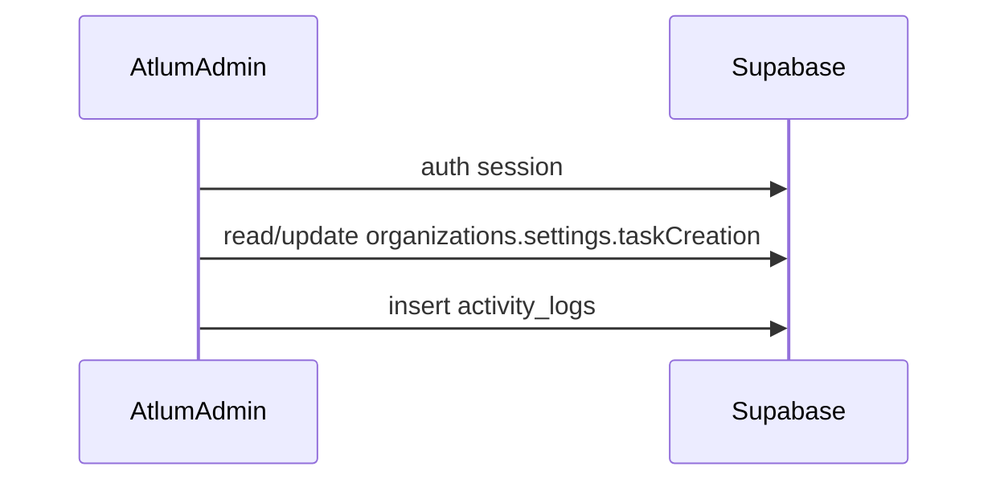

# Create Task Settings

## Related docs

- Backend API (future mobile consumer): [`../../AtlumBackend/docs/feature/BE_CREATE_TASK_SETTINGS_FEATURE.md`](../../AtlumBackend/docs/feature/BE_CREATE_TASK_SETTINGS_FEATURE.md)
- Mobile consumer (phase 2): [`../../AtlumApp/docs/feature/APP_CREATE_TASK_SETTINGS_FEATURE.md`](../../AtlumApp/docs/feature/APP_CREATE_TASK_SETTINGS_FEATURE.md)

## Overview

Admin feature for configuring the mobile **Create Task** form. Admins toggle field visibility/required flags, preview the form in a phone mockup, and persist configuration to Supabase. AtlumAdmin does not call the Backend settings API today.

## Architecture

AtlumBackend exposes `GET/PUT /api/v1/settings/task-creation` for future consumers (e.g. AtlumApp). Admin persists directly to Supabase.

## Key Files

- `src/app/(dashboard)/settings/page.tsx` — Task Configuration page
- `src/components/settings/TaskConfigurationForm.tsx` — Main form state and save/reset
- `src/components/settings/FieldManagementTable.tsx` — Field table with Visible/Required toggles
- `src/components/settings/MobileTaskPreview.tsx` — Live mobile preview
- `src/lib/actions/settings.ts` — Load/save via Supabase + activity log
- `src/types/task-settings.ts` — Shared types and defaults

## API / Data

| Method | Store | Description |
|--------|-------|-------------|
| Server Action | Supabase `organizations.settings.taskCreation` | Primary load/save for Admin UI |

Settings shape is stored as JSONB on the `organizations` table under `settings.taskCreation`.

## Implementation Notes

- Admin uses Supabase Auth only (same as the rest of AtlumAdmin).
- On first load, if the admin profile has no `organization_id`, it is linked to the default organization.
- Core scope: Visible/Required toggles, Reset, Save, mobile preview. Add Field/Tab/Edit/Delete are stubbed with toast.
- Default fields: Task Title, Description, Project Assignment, Task Type (pills), Cost Center (custom example).
- Save writes to `activity_logs` with action type for audit trail.

## Known Issues & Fixes

- Backend JWT bridge for Admin settings removed — caused login hangs when Backend was down.
- `infinite recursion detected in policy for relation 'profiles'` → fixed with `SECURITY DEFINER` helpers (`get_my_role`, `get_my_department`).

## Changelog

| Date | Change |
|------|--------|
| 2026-07-10 | Initial Create Task Settings UI |
| 2026-07-11 | Admin load/save via Supabase; remove Backend session dependency |
| 2026-07-11 | Cleanup: remove unused Admin Backend JWT bridge |

## Testing Checklist

- [ ] Admin login with Supabase credentials reaches dashboard
- [ ] `/settings` loads without errors
- [ ] Toggle Visible/Required updates mobile preview
- [ ] Save Configuration persists after reload
- [ ] Reset to Default restores UI defaults
- [ ] Add Field / Add Tab show "coming soon" toast
- [ ] `activity_logs` row inserted on save
- [ ] Dashboard / Users / Roles still work as before
- [ ] `npm run build` passes in AtlumAdmin
